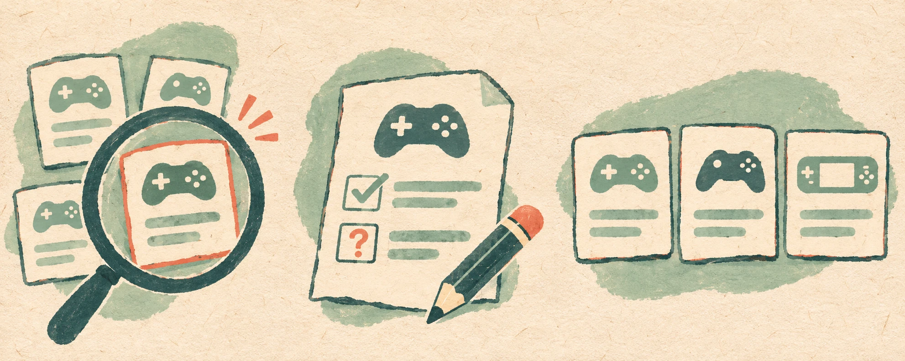
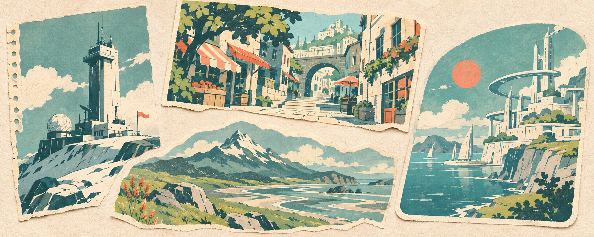
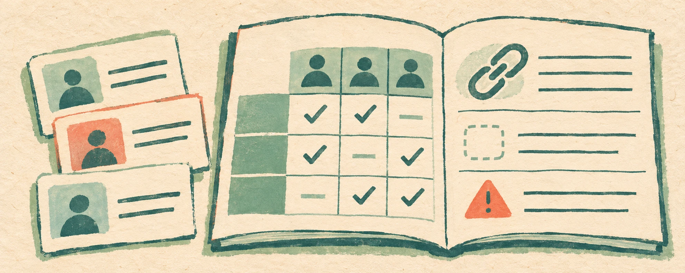
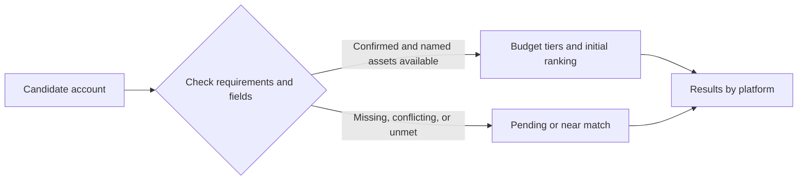
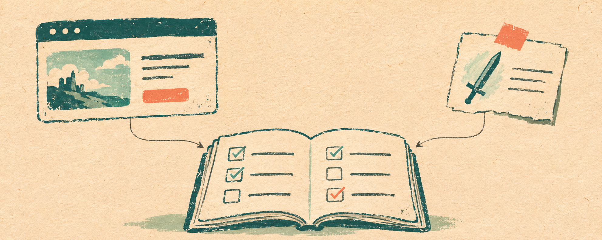
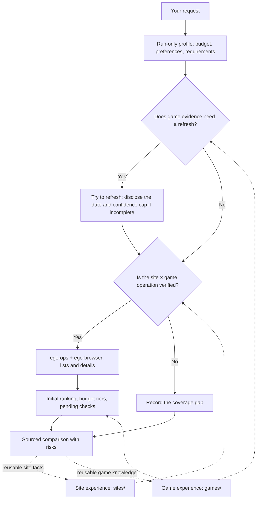

<p align="center">
  
</p>

<h1 align="center">Game Account Select</h1>

<p align="center">
  <strong>Turn your wishlist into a comparison you can understand.</strong><br />
  One Agent Skill to find listings, read details, and weigh the tradeoffs.
</p>

<p align="center">
  <a href="README.md">简体中文</a> · <strong>English</strong><br />
  <a href="#quick-start">Quick start</a> · <a href="#coverage">Coverage</a> · <a href="#how-it-works">How it works</a> · <a href="#extend-and-develop">Develop</a>
</p>

<p align="center">
  <a href="skills/game-account-select/SKILL.md"></a>
  <a href="https://github.com/PointMountain/game-account-select/actions/workflows/verify-game-account-skills.yml"></a>
  <a href="LICENSE"></a>
</p>

Tell your agent which game you want, your budget, and the characters or risks that matter to you. It searches for accounts and returns a sourced shortlist with the details that still need checking.

## What you can do

<p align="center">
  
</p>

| What you can do | What to give the agent |
| --- | --- |
| **Find an account** | Game, budget, server, must-have assets, and preferences |
| **Review one account** | A listing link, screenshots, or seller description, plus your goals |
| **Compare accounts** | Several links or account descriptions and your priorities |

## Quick start

<p align="center">
  
</p>

Prepare **Node.js 22+, git, and gh**, plus the [ego lite](https://lite.ego.app/) browser. Online searches also require discoverable `ego-browser` and `ego-ops` skills. Install this repository's single skill:

```bash
npx skills add https://github.com/PointMountain/game-account-select --skill "game-account-select"
```

Choose your agent when prompted, then start a new session. To update, run `npx skills update`. An installation agent can consult the [optional global-instruction prompt](skills/game-account-select/references/global-agents-prompt.md); writing global instructions requires your explicit permission.

For a first run, ask the agent to check the environment:

```text
Use game-account-select to check whether Node.js, git, gh,
ego-ops, and ego-browser are ready for an account search.
```

Then try a request:

```text
Use game-account-select to find an Arknights account on the official
CN server for up to CNY 1,500. I care most about limited and collab
operators; enough progression for daily play is fine.
Compare PXB7 and PZDS listings, with prices, links, highlights,
and risks that still need checking.
```

<details>
<summary>More examples: review one account or compare several</summary>

```text
Use game-account-select to review this ZZZ account at CNY 800.
I want two playable teams and some pulls saved for later.
Check teams, signature W-Engines, and bindings, and tell me what
is still missing.
Account details: <paste a link or description, or attach screenshots>
```

```text
Use game-account-select to compare these three Wuthering Waves accounts.
Jinhsi is my favorite, so prioritize her team and signature weapon,
then look at the remaining pulls. Explain the tradeoffs in your ranking.
Account A: <link or details>
Account B: <link or details>
Account C: <link or details>
```

</details>

## Coverage

<p align="center">
  
</p>

| Game | PXB7 | PZDS | What to examine |
| --- | --- | --- | --- |
| [Arknights](skills/game-account-select/references/games/arknights/index.md) | List · detail | List · detail | Limited and collab operators, progression, skins, resources |
| [Zenless Zone Zero](skills/game-account-select/references/games/zenless-zone-zero/index.md) | List · detail | List · detail | Agents, Mindscapes, signature W-Engines, teams, resources |
| [Wuthering Waves](skills/game-account-select/references/games/wuthering-waves/index.md) | List · detail | List · detail | Resonators, Resonance Chains, signature weapons, teams, resources |
| [Neverness to Everness](skills/game-account-select/references/games/neverness-to-everness/index.md) | List · detail | List · detail | S characters, Arcs, awakenings, resources, account type |

All 16 site operations were rechecked against live pages on **2026-11-09**. Listings and pages change, so each run checks them again. See the [site index](skills/game-account-select/references/sites/index.md) and operation files for current status; unverified combinations are not silently bypassed.

> As of **2026-11-09**, community strength snapshots for all four games are historical. The skill checks freshness before screening and attempts a refresh when needed. If that refresh is incomplete, it reports the data date and caps recommendation confidence at `medium`. Current strength or team claims require evidence from at least two independent authors published within seven days.

## What you get

<p align="center">
  
</p>

A shortlist shaped by your request: prices and original links, asset highlights, budget tiers, listing and platform verification times, risks, and missing fields. Each platform has its own section; coverage gaps remain visible when there are no suitable results.

A score is an **initial ordering**, not a valuation or transaction guarantee. Count-only accounts without named assets remain pending, and unknown hard conditions do not count as satisfied. The agent does not buy, pay, or contact sellers for you.



## How it works

<p align="center">
  
</p>

One skill handles the flow. Experience is organised under two stable keys: **sites** describe how to query and read each marketplace; **games** describe assets, evidence, and common traps.



Your budget, preferences, and profile are used for the current run and are not written into shared experience. The agent evaluates the evidence before writing reusable site or game knowledge; only real successes update verification dates. This is a skill workflow, not background monitoring or an enforcement hook.

## Extend and develop

For a new game, start with its game directory, signal table, and evidence-refresh operation. For a new site or site × game combination, add the corresponding list/detail operations and manifest entries. New page structures may also need parser changes and tests. See [adding a game or site](skills/game-account-select/references/workflow.md#新增游戏或站点).

```text
skills/game-account-select/
├── SKILL.md                  Entry point and run protocol
├── scripts/                  Profile, freshness, queries, shortlist, cleanup
├── references/
│   ├── sites/<site>/         Site facts and per-game list/detail operations
│   └── games/<game>/         Assets, risks, signals, and evidence
└── tests/                    Offline regressions and parser fixtures
```

Local development and verification:

```bash
npm run list:skills
npm run dev:context -- --files skills/game-account-select/scripts/shortlist.mjs
npm run dev:check
npm run verify:skills
```

Changes to site operations or parsers also require a real ego-browser run and task-space cleanup; an offline pass alone does not prove live behavior. See the [development workflow](docs/development/workflow.md), [verification boundaries](docs/development/verification.md), and [OPS model](skills/game-account-select/references/ops-model.md).

---

Found a problem or want to add a game? [Open an issue](https://github.com/PointMountain/game-account-select/issues).

[MIT License](LICENSE) · Made for your next adventure.
