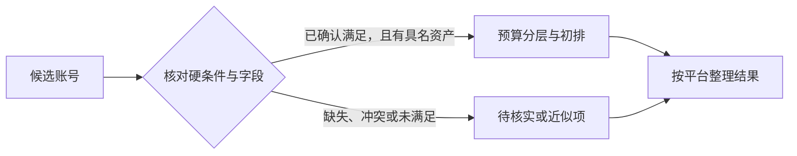
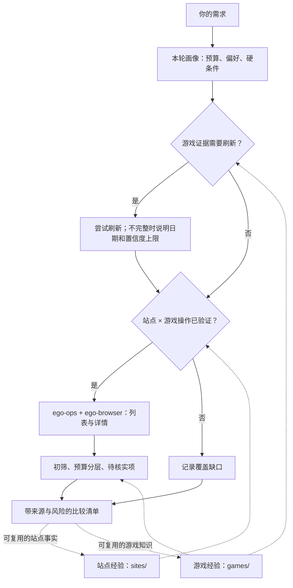

<p align="center">
  
</p>

<h1 align="center">Game Account Select</h1>

<p align="center">
  <strong>把愿望清单变成看得懂的账号比较。</strong><br />
  一个 Agent Skill，帮你找号、读详情、比较取舍。
</p>

<p align="center">
  <strong>简体中文</strong> · <a href="README.en.md">English</a><br />
  <a href="#快速开始">快速开始</a> · <a href="#支持范围">支持范围</a> · <a href="#工作方式">工作方式</a> · <a href="#扩展与开发">扩展与开发</a>
</p>

<p align="center">
  <a href="skills/game-account-select/SKILL.md"></a>
  <a href="https://github.com/PointMountain/game-account-select/actions/workflows/verify-game-account-skills.yml"></a>
  <a href="LICENSE"></a>
</p>

告诉 Agent 你想玩什么、预算多少、在意哪些角色或风险，它会按你的要求查询账号，提供带来源的候选清单，并标出还需要核实的地方。

## 你可以做什么

<p align="center">
  
</p>

| 你可以做什么 | 给 Agent 的材料 |
| --- | --- |
| **主动找号** | 游戏、预算、区服、必须有的资产和偏好 |
| **评估一个号** | 商品链接、截图或卖家描述，以及你的目标 |
| **比较几个号** | 多个链接或账号资料，以及你最在意的取舍 |

## 快速开始

<p align="center">
  
</p>

准备 **Node.js 22+、git、gh**，以及 [ego lite](https://lite.ego.app/) 浏览器；在线查询还需要可发现的 `ego-browser` 和 `ego-ops` 技能。然后安装本仓库唯一的 Skill：

```bash
npx skills add https://github.com/PointMountain/game-account-select --skill "game-account-select"
```

按提示选择 Agent，安装后开启一个新会话。需要更新时运行 `npx skills update`。安装 Agent 可以参考[可选的全局前置提示词](skills/game-account-select/references/global-agents-prompt.md)；写入全局指令需要你的明确授权。

第一次使用可以先让 Agent 检查环境：

```text
用 game-account-select 检查我的找号环境，看看 Node.js、git、gh、
ego-ops 和 ego-browser 是否准备好了。
```

然后试试：

```text
用 game-account-select 帮我找明日方舟国服官服号，预算 1500 元以内。
我更在意限定和联动干员，练度够日常用就好。
比较螃蟹和盼之的候选，列出价格、链接、亮点和需要核实的风险。
```

<details>
<summary>更多示例：评估单号或比较多个账号</summary>

```text
用 game-account-select 看看这个绝区零账号，卖家报价 800 元。
我想接手后有两队能玩，也想留些抽卡资源。
请核对阵容、专属音擎和绑定情况，并说明哪些信息还不完整。
账号资料：<粘贴链接或描述，或附上截图>
```

```text
用 game-account-select 比较下面三个鸣潮账号。
我喜欢今汐，优先看她的队伍和专武，再看剩余抽卡资源。
按适合我的程度排序，解释每个账号的取舍。
候选 A：<链接或资料>
候选 B：<链接或资料>
候选 C：<链接或资料>
```

</details>

## 支持范围

<p align="center">
  
</p>

| 游戏 | 螃蟹 PXB7 | 盼之 PZDS | 重点查看 |
| --- | --- | --- | --- |
| [明日方舟](skills/game-account-select/references/games/arknights/index.md) | 列表 · 详情 | 列表 · 详情 | 限定与联动、练度、皮肤、资源 |
| [绝区零](skills/game-account-select/references/games/zenless-zone-zero/index.md) | 列表 · 详情 | 列表 · 详情 | 代理人、影画、专属音擎、配队、资源 |
| [鸣潮](skills/game-account-select/references/games/wuthering-waves/index.md) | 列表 · 详情 | 列表 · 详情 | 共鸣者、共鸣链、专武、配队、资源 |
| [异环](skills/game-account-select/references/games/neverness-to-everness/index.md) | 列表 · 详情 | 列表 · 详情 | S 角色、弧盘、觉醒、资源、账号类型 |

上述 16 个站点操作于 **2026-11-09** 真实复验；商品与页面会变化，运行时仍需复核。操作状态以[站点索引](skills/game-account-select/references/sites/index.md)及对应文件为准；未验证的组合不会自动绕过限制。

> 截至 **2026-11-09**，四款游戏的社区强度快照仍是历史数据。筛选前会检查新鲜度并在需要时尝试刷新；如果刷新未完成，会说明数据日期并将推荐置信度限制为最高 `medium`。当前强度或配队主张需要 7 天内至少两位独立作者的证据。

## 你会拿到什么

<p align="center">
  
</p>

一份按本轮需求整理的清单：价格和原始链接、资产亮点、预算分层、上架与平台验号时间、风险及缺失字段。两个平台分别列出；没有合适结果时保留覆盖缺口。

筛选分数只是**初排**，不是账号估值或交易保证。只有数量、没有具名资产的账号会留在待核实项；未知硬条件不会被当作满足。Agent 不会替你购买、付款或联系卖家。



## 工作方式

<p align="center">
  
</p>

一个 Skill 负责完整流程，经验按两个稳定主键组织：**站点**记录怎么查、怎么读；**游戏**记录该看什么、有哪些坑。



用户的预算、偏好和画像只用于本轮，不写入共享经验。Agent 会依据本次证据判断是否写回站点或游戏知识；只有真实成功才更新验证日期。这是 Skill 的工作协议，不是后台监控或强制拦截。

## 扩展与开发

新增游戏时，从游戏目录、信号表和证据刷新操作开始；新增站点或站点 × 游戏组合时，补对应的列表／详情 operation 和清单。需要支持新的页面结构时，还要补解析器与测试。完整步骤见[新增游戏或站点](skills/game-account-select/references/workflow.md#新增游戏或站点)。

```text
skills/game-account-select/
├── SKILL.md                  入口与运行协议
├── scripts/                  画像、新鲜度、查询、筛选与清理
├── references/
│   ├── sites/<site>/         站点事实和游戏列表／详情操作
│   └── games/<game>/         游戏资产、风险、信号表与证据
└── tests/                    离线回归与解析样例
```

本地开发与验证：

```bash
npm run list:skills
npm run dev:context -- --files skills/game-account-select/scripts/shortlist.mjs
npm run dev:check
npm run verify:skills
```

站点操作或解析器的改动还需要真实 ego-browser 验证与任务空间清理；离线通过不等于线上通过。详见[开发流程](docs/development/workflow.md)、[验证边界](docs/development/verification.md)和 [OPS 模型](skills/game-account-select/references/ops-model.md)。

---

遇到问题或想接入新游戏？欢迎[提交 Issue](https://github.com/PointMountain/game-account-select/issues)。

[MIT License](LICENSE) · Made for your next adventure.
